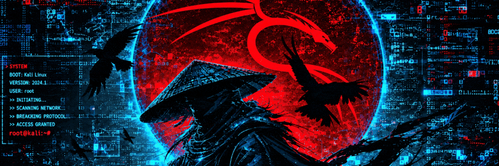

<!-- Banner Animado en Bucle Infinito -->

  

<!-- Botones de Redes Sociales (Alineados y limpios sin líneas azules) -->

  &nbsp;
  &nbsp;
  &nbsp;
  &nbsp;
  

<!-- Título y Rol Principal -->
<h3 align="center">
  CEO & Co-Founder of RedOps Ninja | Hacker | Red Team | Pentester
</h3>

  <strong>BSCP</strong> • <strong>CWL</strong> • <strong>TryHackMe</strong> • <strong>CTF Player</strong> • <strong>16K+ Cybersecurity Community</strong>

<!-- Arsenal y Tecnologías -->

  
  
  
  
  
  
  

<!-- Patrocinio y Contacto -->

  &nbsp;
  

---

<!-- Estadísticas en Dark / Red Theme adaptadas -->

  
  

